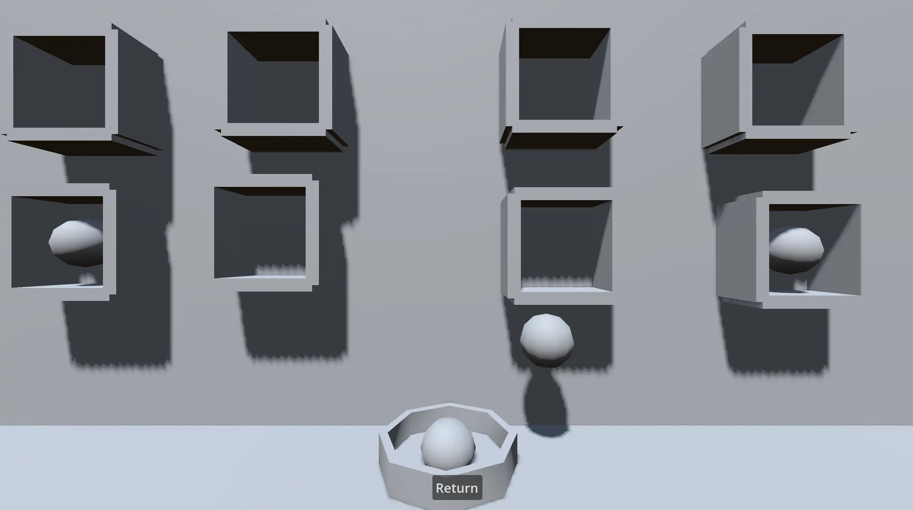

## Sample project
Sample project for [u/maxdafoxo](https://www.reddit.com/user/maxdafoxo/) regarding this [post](https://www.reddit.com/r/godot/comments/1y04anj/coding_characterbody3d_snapping_to_marker3d/) seeking for help

> Not quite sure how I'd do this, I keep seeing a lot of tutorials for 2d. Basically in my game you click items to put them into a soup, I want to have a code that either plays an animation of it going into the soup when clicked, or just teleport the mesh there. Additionally, there's a "reset" button in the pot, I'd like code for one animation of it going into the pot, and a separate of it being removed. I was wondering if there was any easy code for that. I cant seem to find any tutorials on something like this. There also is a limit of 6 items, so i'd basically want to try and get the clicks of each item assigned to a random spot of 6 options in the soup. If this just not possible or too much work please let me know, I know nothing of code and I'm trying my best to do research but haven't found anything. 

### [**Check out game directly on GH Pages**](https://max-seidel.github.io/max_da_foxo_soup_game/builds/web/)

